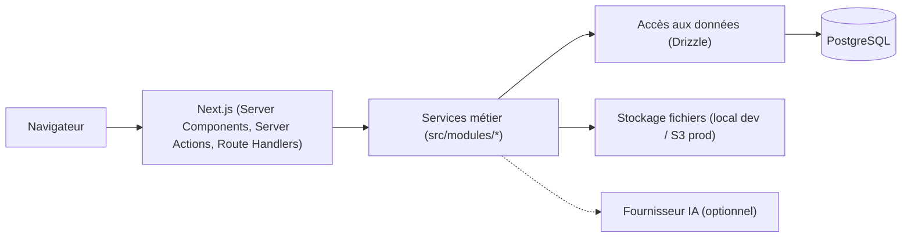

# Architecture technique

Statut : Phase 0. Mis à jour à chaque phase. Les points non tranchés sont marqués **À DÉCIDER**.

## A. Vue générale

Application Next.js full-stack (App Router) + PostgreSQL. Pas de backend séparé (ADR-001).

## B. Application

- **Server Components par défaut.** Client Components uniquement pour l'interactivité (thème, lecteur, quiz, examens).
- **Server Actions** : formulaires et mutations simples. **Route Handlers** : téléchargements, webhooks, intégrations.
- Validation Zod à chaque frontière (entrées de formulaire, variables d'environnement : `src/lib/env.ts`).
- Middleware : à définir en Phase 1 (protection des routes).

## C. Modules (cible)

Auth, Users, Repositories, Import Engine, Content Engine, Course Builder, Learning Paths, Courses/Lessons, Labs, Quizzes, Exams, Flashcards, Revisions, Progress, Mastery, Achievements, AI Tutor, Search, Administration.
Un module vit dans `src/modules/<nom>/` (services + accès aux données + types). Les modules communiquent par leurs services, jamais par leurs tables.
Phase 0 : aucun module métier n'existe encore. Seuls `src/lib` (env, thème, db) et `src/components/{ui,layout}` sont posés.

## D. Données

PostgreSQL via Drizzle, migrations versionnées dans `drizzle/`. Le schéma (`src/lib/db/schema.ts`) est vide en Phase 0 : les tables arrivent phase par phase.
Séparation prévue : _contenu source_ (immuable, hash + chemin + version) / _contenu édité_ (Course Builder).

## E. Couches

UI → cas d'usage → domaine → accès aux données → PostgreSQL/stockage. Pas de règle métier complexe dans les composants.

## F. Import (voir `content-import-specification.md`)

Pipeline extensible à adaptateurs. Aucun code spécifique à un repository hors des adaptateurs.

## G. IA (voir `ai-guidelines.md`)

Interface de fournisseur, désactivable (`AI_PROVIDER=none`), fournisseur simulé pour les tests, pgvector en Phase 11.

## H. Sécurité — frontières de confiance

Client (non fiable) · Serveur · Base de données · Sources importées (non fiables, jamais exécutées) · Services externes · IA (contenu importé = données, pas instructions) · Fichiers (validation de type réel, taille, ZIP Slip) · Administration (rôles).

## I. Diagrammes

Ajoutés avec chaque moteur (Import, Progress, Quiz, RAG, publication) lors de sa phase.

## J. Décisions

Voir `docs/adr/`.

## État vérifié en Phase 0

Développement : `pnpm dev`. Variables : `.env.example`. PostgreSQL : `docker-compose.yml` (image `postgres:17`).
pgvector n'est pas inclus dans cette image : **À DÉCIDER** en Phase 11 (image `pgvector/pgvector`).
